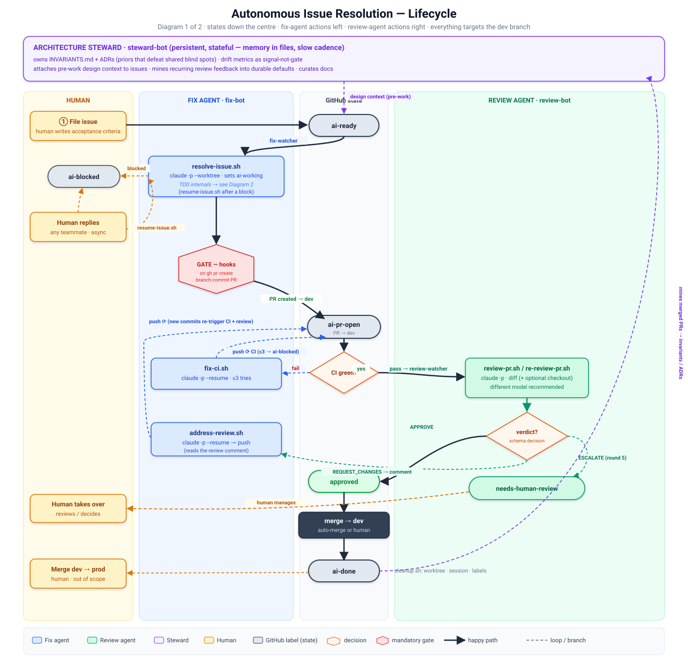
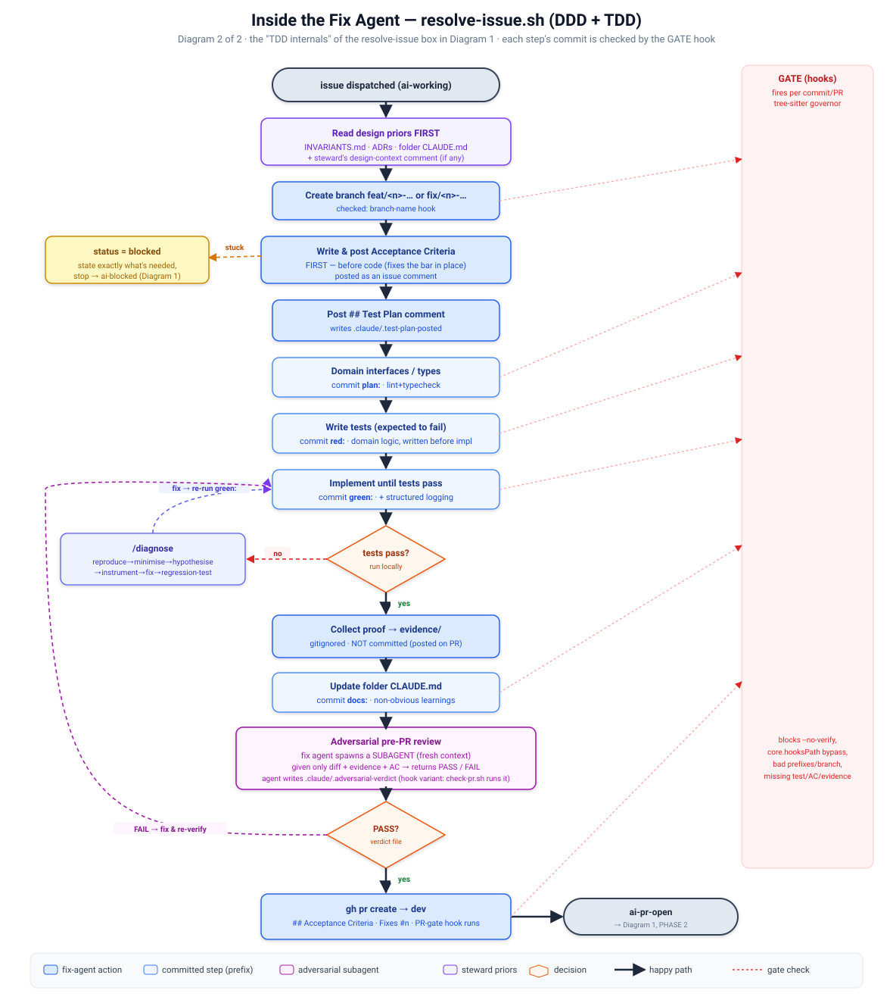

# Autonomous Issue Resolution with Claude Code (v2)

A local, headless harness that resolves GitHub issues end-to-end: issue → branch →
TDD implementation → PR → CI → review → merge to the **dev branch**. It pauses for a
human only when genuinely stuck. Promotion from `dev` to a protected/prod branch stays
a human decision and is out of scope here.

This is a general framework meant to be dropped into any repo as a `.claude/` plugin and
shared between collaborators. It is provider- and organization-agnostic: point it at any
GitHub repo, any OpenAI-compatible or Anthropic model gateway, via environment config.

> **▶ The design below has been implemented, and then superseded.** The harness
> was ported from bash orchestration to a Python + Claude Agent SDK core; the
> runnable path is now `src/issue_agent/` (hexagonal: `domain/` pure, `adapters/`
> I/O, `app/` wiring) plus `plugin/` (enforcement). The bash watchers have been
> deleted; the nine `0N-*.md` specs in [docs/archive/](docs/archive/) are
> historical only. Codex uses the Python daemon plus the shared gate scripts.
>
> **For the current system, start with
> [docs/reference/architecture.md](docs/reference/architecture.md)**, then
> **[HARNESS.md](HARNESS.md)** for the operator's manual. What is still open is
> in [docs/open/residuals.md](docs/open/residuals.md); the self-test suite is
> ~1,500 tests via `make test`. [docs/README.md](docs/README.md) says what every
> document is for and whether to trust it.

## Quickstart

Install once, then point the harness at any repo from inside it:

```bash
make install                       # uv sync (editable) + ~/.local/bin/issue-agent shim

cp config/shared.example.env config/shared.env   # then fill it in (see below)

cd /path/to/your-repo
issue-agent start                  # auto-init, auto-detect repo + test cmd, run all 3 daemons
issue-agent ready <issue-number>   # label an issue ai-ready → the fixer picks it up
```

`issue-agent start` runs in the foreground (Ctrl-C stops everything) and does the
whole first-run flow: creates `config/shared.env` interactively if absent, detects
`REPO`/`TARGET_DIR` from the cwd, discovers your `TEST_CMD`, and launches the fix +
review daemons. `issue-agent doctor` checks prerequisites; `issue-agent
status` shows what's running.

**Foreground is the dev / first-run mode.** Once it's proven your config works,
run it for real — supervised, auto-restarting across a suspend/OOM-kill/reboot —
with `issue-agent install-service` (systemd on Linux, launchd on macOS). See
[HARNESS.md "Running for real"](HARNESS.md#running-for-real-systemdlaunchd-is-the-documented-default)
for details.

### What you must supply — the reviewer runs as a GitHub App

The fixer acts as **your** `gh auth` login. The **reviewer acts as a GitHub
App**, not a PAT — GitHub returns *422 "can not approve your own pull request"* if the
reviewer shares the author's identity, and an App gives a clean second bot with
short-lived auto-minted tokens. One-time setup:

1. **Create a GitHub App** (org-level). Permissions: `pull_requests:write`,
   `issues:write`, `contents:read`, `metadata:read`.
2. **Generate + download its private key** (`.pem`).
3. **Install the App** on your org/repo and note the installation ID.
4. In `config/shared.env` set the three App values + your fixer login:

   ```bash
   GH_APP_ID="<app-id>"
   GH_APP_INSTALL_ID="<installation-id>"
   GH_APP_KEY_FILE="$HOME/.config/<app>/private-key.pem"
   FIX_BOT="<your-gh-login>"        # MUST differ from the App (the 422 rule)
   ```

   `REVIEW_BOT` defaults to `my-reviewer-bot[bot]`, so if you name
   your App that you need only supply the key file. Otherwise set them to your App's
   login. See [`config/shared.example.env`](config/shared.example.env) for the full
   annotated template, and [HARNESS.md](HARNESS.md) for the operator's manual.

### LLM credentials — the daemons use *your* Anthropic auth

The GitHub App identity is only for git actions. The **model** each agent drives uses
whatever Anthropic auth is in the shell that launches the harness — the daemons inherit
that environment (nothing is hardcoded). Two ways to provide it:

- **Env (wins if set):** export `ANTHROPIC_API_KEY` (or `ANTHROPIC_AUTH_TOKEN` +
  `ANTHROPIC_BASE_URL` for a gateway) before `issue-agent start`. Put these in the
  launching shell, not `shared.env` — they're operator/machine-level, not repo config.
- **On-disk Claude Code login:** if no `ANTHROPIC_*` env var is set, the SDK falls back
  to your interactive `claude` credentials (`~/.claude/.credentials.json`).

Either way this bills **your** Anthropic account/quota — the reviewer is *not* a
separately-metered LLM identity (unlike its distinct GitHub App). A long-running
two-daemon deployment can consume meaningful token spend; the per-agent budget caps
(`MAX_BUDGET_USD`, `REVIEW_BUDGET_USD`) bound each run.

## Document map

This design is split across files (each is self-contained and edit-friendly):

1. [Fix Agent Plugin Structure](docs/archive/01-plugin-structure.md) — `.claude/` layout, real `settings.json` hook schema
2. [Hook Layer: tree-sitter Bash Governor](docs/archive/02-hook-governor.md) — AST dispatcher, bypass detection, the three checks
3. [Fix Agent Specification](docs/archive/03-fix-agent-spec.md) — DDD+TDD flow, commit prefixes, adversarial pre-PR, `AGENT.md`
4. [Fix Agent Scripts](docs/archive/04-fix-scripts.md) — crash-safe `lib.sh`, resolve/resume/fix-ci/address-review/cleanup
5. [Fix Watcher](docs/archive/05-fix-watcher.md) — single sequential fixer, reaper, CI-state mapping, service units
6. [Review Agent](docs/archive/06-review-agent.md) — separate identity, schema decisions, `--reviewer-runs-tests` flag
7. [Architecture Steward (Gardener)](docs/archive/07-gardener-steward.md) — **stateful** design/docs/drift owner *(v3 rewrite — see file)*
8. [Master Agent](docs/archive/08-master-agent.md) — on-demand status query
9. [Bootstrap, Labels, Ops, Properties](docs/archive/09-bootstrap-and-ops.md) — setup, taxonomy, safeguards, open risks

**Diagrams:**
- [`process-diagram.svg`](process-diagram.svg) — the full lifecycle as a flowchart (the four phases, all loops, three agents, human touchpoints)
- [`fixer-internals-diagram.svg`](fixer-internals-diagram.svg) — inside `resolve-issue.sh`: the DDD+TDD steps, the `/diagnose` and adversarial-review loops, and which step each GATE hook checks

> **Architectural roadmap (v3).** Beyond technical correctness, the harness needs organs for
> *conceptual integrity* and *compounding learning*, not just throughput. The plan: promote the
> gardener from a stateless weekly scanner into a **persistent, memory-bearing steward** that
> encodes invariants the base model lacks (attacking shared blind spots), reads drift
> instrumentation as a Goodhart-resistant fitness signal, mines recurring review feedback into
> evolving `AGENT.md`/ADR defaults, and curates docs. Plus a different-model reviewer for
> decorrelated judgement. See [07-gardener-steward.md](docs/archive/07-gardener-steward.md).

> **v2 rewrite.** v1 (`autonomous-issue-agent.v1-original.md`) had a sound skeleton —
> *detect event → `claude -p` → check outcome → loop, with GitHub as the bus* — but the
> enforcement layer was built on an invented hooks schema, control flow trusted the model's
> prose, and `set -euo pipefail` turned every transient error into a silent permanent
> deadlock. v2 fixes those three classes and the downstream bugs they caused.

## Corrections from v1 (summary)

| Area | v1 defect | v2 fix |
|------|-----------|--------|
| Hook schema | `{"Bash":{"pre":[{"match",...,"blocking"}]}}` — not real | Real `PreToolUse`/`matcher`/stdin-JSON; one tree-sitter **dispatcher** |
| Command routing | String `match` against command text | tree-sitter AST: finds governed commands even inside `&&`, `;`, `$(…)`, subshells, heredocs |
| Identity | One `BOT_ACCOUNT` for fix+review | Two identities (`fix-bot` ≠ `review-bot`); fixes self-approval + loop deadlock |
| Outcome detection | `grep` the model's prose | GitHub ground truth + `--json-schema` → `.structured_output` |
| Error handling | `set -e` aborts on any non-zero `claude`/`gh` | Capture rc; read `is_error`/`subtype`; never strand `ai-working`; reaper |
| Daemon | `set -e` loop dies on first transient `gh` error | Crash-isolated iterations + service-level auto-restart + backoff |
| Concurrency | Unbounded background fan-out, fictional area locks | **Single fixer**, sequential dispatch (conflict-free by construction) |
| Tests in hook | Full suite in a blocking commit hook | Lint/typecheck/bypass-detection in hook; tests run in CI |
| Branch vs worktree | `gh run list --branch issue-N` (the worktree name) | Derive real `headRefName` from the PR |
| Resume cwd | Resume without re-entering the worktree | Every resume re-enters the worktree; verified before tool use |
| Evidence on main | "auto-deleted on merge" — unimplemented | `evidence/` is gitignored; posted to the PR as a comment, never committed |
| `grep -oP '\K'` | BSD grep on macOS has no `-P` | tree-sitter / `gh` JSON / `sed -E` |

## Verified against the runtime

Everything below was checked against Claude Code `2.1.170` on macOS before writing:

- **Flags exist:** `--worktree`, `--resume`, `--fork-session`, `--output-format json`,
  `--json-schema`, `--max-budget-usd`, `--append-system-prompt`,
  `--permission-mode bypassPermissions`, `--tools`, `--disallowed-tools`.
- **Exit codes:** bad flag / worktree-not-a-repo → exit **1**; success → **0**. A non-zero
  `claude` inside `$(…)` under `set -e` aborts the caller — this is the deadlock source.
- **Structured output** lands in top-level **`.structured_output`** (not `.result`), next to
  `is_error`, `subtype`, `stop_reason`, `total_cost_usd`, `num_turns`.
- **Hook contract:** a `PreToolUse`/`Bash` hook receives the call as JSON on **stdin**
  (`.tool_input.command`); **exit 2 + stderr** blocks the call. The `matcher` matches the
  **tool name** (`Bash`), never the command string.
- **tree-sitter-bash** (`Parser(Language(tsb.language()))`) parses compound/nested commands;
  a PEP 723 inline-deps script self-bootstraps via `uv run` in ~90–130 ms warm.

## Design

Three independent systems coordinating only through GitHub: a **fix agent**, a **review agent**,
and an **architecture steward**. Neither the fixer nor the reviewer knows the other is an agent;
a human can substitute for either at any point. The steward (a persistent, stateful session)
sits above the issue loop and owns conceptual integrity — see
[07-gardener-steward.md](docs/archive/07-gardener-steward.md).

```
FIX AGENT  (identity: fix-bot)            REVIEW AGENT (identity: review-bot)
──────────────────────────────           ───────────────────────────────────
issue (ai-ready)                          
  → resolve headless (one at a time)      
  → open PR (base = dev)                  PR appears (author = fix-bot)
                                            → review headless
  review arrives (author = review-bot)      → APPROVE / REQUEST_CHANGES
  → address feedback headless             
  → push                                  new commits detected
                                            → re-review headless
  CI fails                                  → APPROVE / REQUEST_CHANGES
  → fix CI headless                       
  → push                                  ...4 rejections, then ESCALATE...

                approved → merge to dev (auto or human)
                watcher detects merge → both agents clean up
```

Why distinct identities (`fix-bot` ≠ `review-bot` ≠ `steward-bot`): GitHub returns
**422 "Can not approve your own pull request"** if author and reviewer are the same account, and
the fix watcher's "did a human/other party reply?" check is `author != self` — a shared identity
makes the review agent invisible to the fix agent. The steward gets its own read+comment identity
so its design comments stay out of that reply logic. Use a GitHub App installation token per
identity (least privilege), or separate machine users.

Why a single fixer: file-level conflict-freedom is trivial to guarantee when one agent works one
issue at a time — two PRs are never built concurrently, so they cannot race on the same files. No
`area/*` labels, no cross-machine mutex, no double-dispatch, and no file-set lock (the sequential
fixer already provides the guarantee a lock would add).

## Full Lifecycle



The fixer's internal TDD flow (the `resolve-issue` box above) is detailed separately:



A text fallback of the phases:

```
PHASE 1 — Resolve issue
  resolve-issue.sh → claude -p --worktree (headless)
    structured_output.status == pr_opened?  ──yes──→ PHASE 2
       │ no (blocked)
       ▼
    post question to issue, label ai-blocked
       │ human replies (any human, async)
       ▼
    resume-issue.sh → claude -p --resume (re-enters worktree)
       └──→ loop until pr_opened

PHASE 2 — CI
  watcher polls CI on ai-pr-open PRs
    all checks green?  ──yes──→ wait for review
       │ failure
       ▼
    fix-ci.sh → claude -p --resume with failure log
       └──→ loop (max 3 attempts → ai-blocked)

PHASE 3 — Address review
  review-bot requests changes
    address-review.sh → claude -p --resume → push
       └──→ loop until APPROVE (or review agent ESCALATEs after 4 rejections)

PHASE 4 — Merge + cleanup (dev branch)
  PR approved + merged into dev (auto-merge or human)
    watcher detects merge → cleanup.sh
      remove worktree, delete session/state, relabel ai-done
```

---

[Index](README.md) · Next: [Fix Agent Plugin Structure](docs/archive/01-plugin-structure.md)  →
