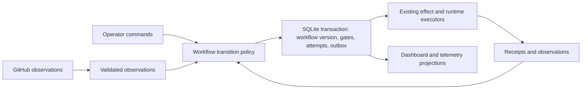

Architectural review of autonomous-issue-agent — 2026-09-14

Archive note: copied from `/tmp/architecture-review-2026-09-14/report.md`.
Relative evidence-artifact links below refer to that original review directory;
the isolated-checkout links are historical provenance, not current source paths.
Implementation status and retained baseline live in
[the implementation plan](2026-09-14-architecture-implementation.md).

Reviewed commit: `d26e935a091baa067ee0ac404157d9388116a217`.

**Assessment.** The concern is supported by evidence. This repository has substantially improved its control-plane safety, but it has not demonstrated a sustained reduction in operational gaps. Its strongest architectural patterns coexist with an incomplete workflow model: money, commands, ownership and receipts have durable authority; human holds, retry episodes, continuation and eligibility still depend on several representations that must be manually kept consistent. Many later fixes repair interactions between those representations.

The best investment is a focused overhaul of workflow state, gates and recovery around the existing control plane. Preserve the pure domain decisions, SQLite admission, effect receipts, revision fences and process supervision. Moving files into smaller modules alone would leave the main causes intact. A replacement orchestration framework or distributed service deployment is not justified by the evidence gathered here.

This is a report only. No implementation, configuration, service, remote issue or commit changes were made by the review agents. Analysis artifacts and an isolated test checkout are under `/tmp`. Other work appeared in the shared checkout during the review, including subsequent commit `4c365a8`; it was left untouched and is excluded from this baseline's counts and test results. Code findings and measurements below are anchored to the named commit.

**Scope and method.** I inspected the current architecture documents and ADRs; the 122-entry failure-mode catalog; the field-verification ledger; July–August deployment reports; all 512 commits reachable from HEAD at the metadata level; selected historical patches and regression chains; and current domain, application, runtime, store, publication, recovery, configuration, dashboard and test boundaries. An independent reviewer examined current code and reproduced findings. This was architectural review and targeted verification, not exhaustive line-by-line verification of every module, a penetration test, or a new live deployment. No live production journals or GitHub issue inventory were queried; operational conclusions use the checked-in reports.

Commit analysis excludes the 32 merge commits. Dates are committer dates. “Production-changing” means a commit touches `src/`, `plugin/`, `bin/`, `ops/`, `scripts/` or `dashboard/src/`. “Fix-labelled” means its subject begins with `fix`, followed by a colon, parenthesis or whitespace, case-insensitively. This is a reproducible repair-work proxy, not a count of defects: some fixes have `feat` subjects, one commit can fix several defects, and audit catches are mixed with deployed incidents. [Commit data](commits.csv), [analysis script](metrics.py), [summary](summary.json).

**There is no demonstrated downward trend in gaps.**

| Commit-date interval | Production-changing commits | Fix-labelled production commits | Fix share |
|---|---:|---:|---:|
| July 21–27 | 75 | 41 | 54.7% |
| July 28–August 3 | 208 | 149 | 71.6% |
| August 4–10 | 73 | 40 | 54.8% |
| August 11–September 13 | 0 | 0 | Not measurable |
| September 14 | 2 | 1 | Sample too small |

Repair work falls from the hardening peak, but returns approximately to the first week's proportion. It does not form a sustained downward series. The long period with no production commits is not evidence of defect-free operation: an August 20 handover records continuing operation and gaps despite only a documentation commit in that interval. Conversely, the high July 31 fix volume includes deliberate adversarial discovery; it is not evidence that all those defects escaped to production.

The deployment reports also do not provide a comparable defect-rate series:

| Report | Outcomes | What it establishes | Limitation |
|---|---|---|---|
| August 8 | 10/10 managed items merged; spending/approval window uses 9 | Useful throughput; 2/9 first-pass approvals; two PRs took 7 and 11 review rounds | Eight “gap” bullets mix defects, configuration and operational notes; heavy human assistance |
| August 9, batch 3 | 11 merges, one parked; $77.03/80 paid legs | Review/fix collision and free-rerun fixes fired successfully; repeated human re-arms still required | Eleven “gap” bullets include features and policy changes; some bullets contain several root causes |
| August 20 | 2 merges; one newly authored PR approved first round | Free rerun reconfirmed; recurrence routing exercised | One inherited PR had been blocked almost seven days; three harness gap references, only one newly filed; tiny and selected sample |

Sources: [August 8 report](/tmp/architecture-review-head/docs/open/2026-08-08-handover-tauri-batch.md:8), [August 9 report](/tmp/architecture-review-head/docs/open/2026-08-09-batch3-report.md:8), [August 20 report](/tmp/architecture-review-head/docs/open/2026-08-20-handover-tauri-takeover.md:7).

The intervention metric explicitly omits manual GitHub-side work; it is a lower bound on human involvement. It classifies what an operator did, not whether a defect, policy choice or judgment caused it. Recurrence is also not a complete harness-defect metric: target defects can be unrelated, and the August 2 notes document an incorrect model-suggested recurrence. Neither metric currently answers this review's causal question. [Metric contract](/tmp/architecture-review-head/src/issue_agent/domain/dashboard.py:1339), [recurrence false positive](/tmp/architecture-review-head/docs/open/2026-08-02-report-notes-wip.md:1).

The proposed 48-hour unattended soak remains recorded as “not yet started.” I found no completed readout in the reviewed tree. That means unattended convergence has not been demonstrated by the repository evidence reviewed here; it does not establish that nobody ever ran a soak elsewhere. [Soak protocol](/tmp/architecture-review-head/docs/open/soak-protocol-unattended-48h.md:1).

The field ledger has 110 table rows: 46 begin pending, 3 UNVERIFIED, 2 PARTIAL, 53 VERIFIED, 3 MISBEHAVED, and 3 free-form statuses. These are row counts, not 110 independent changes or a closure rate. Some VERIFIED rows also record a misbehaving branch, and later verdict rows revisit earlier changes. At least 49 rows still explicitly begin pending/unverified. Its honesty is valuable; its structure is unsuitable for calculating net open defects. [Extracted ledger](verification.csv).

**Incidental versus systemic: an auditable classification, with limits.** I classified every numbered entry in the historical catalog. A systemic entry concerns a missing or inconsistent shared invariant, authority, lifecycle transition or cross-component contract. An incidental entry concerns a localized coding/tool/configuration mistake without evidence that a broad redesign is necessary. Mixed entries have an external, configuration or model trigger amplified by a harness design weakness. Policy/enhancement entries are separated because not every inconvenience is a defect.

| Classification | Catalog entries | Share of all 122 |
|---|---:|---:|
| Systemic | 51 | 41.8% |
| Incidental | 37 | 30.3% |
| Mixed | 18 | 14.8% |
| Policy / enhancement / expected limitation | 13 | 10.7% |
| Root cause uncertain | 3 | 2.5% |

Thus architecture is implicated in 69 catalog entries: 51 systemic plus 18 mixed. Excluding policy/enhancement and uncertain entries gives 69/106, about 65%, of the classifiable defect/problem entries. Treat that as this reviewer's assessment of a selected historical corpus, not “65% of all production bugs are caused by bad architecture.” The catalog includes development-tool errors, multiple entries in the same family (#34/#35; the deployment-ownership cluster #116–#122), multi-defect entries (#110), pre-public-release incidents, and stale OPEN/FIXED headings. It largely predates the latest implementation and cannot describe today's backlog or a chronological rate. Each judgment and rationale is in the [classification CSV](failure-mode-classification.csv).

The later audit-added entries #104–#122 classify as 18 systemic and one incidental. That is evidence that serious reviews kept finding authority/convergence problems, but the sample was selected by architectural audits, so its 95% systemic share must not be generalized. Excluding those audit additions, the architecture-implicated proportion is 51/87 classified defect entries, approximately 59%. That sensitivity check better expresses the conclusion: architecture contributes substantially, while the precise percentage depends on selection and classification. Borderline entries can reasonably move categories in either direction. Recent deployment examples corroborate the same families without providing a clean denominator.

**The improvements worth preserving are substantial.** The enforced domain/adapters/app layering supports pure decisions and testable effects. `DurableEffectRunner` centralizes command transitions and receipts; reservation recovery has a pure decision model with runtime validation; SQLite gives admission and ownership transactional scope; publication checks captured revisions and reconciles ambiguous outcomes; process supervision tracks descendants and deployment retirement. These directly address earlier failures involving success-path-only bookkeeping, daemon-versus-child lifetime, shared budget scope and old writers surviving repoints. The repository has substantive integration, crash-recovery, parity and migration tests, not merely rendering tests. [Durable effects](/tmp/architecture-review-head/src/issue_agent/adapters/durable_effects.py:66), [recovery model](/tmp/architecture-review-head/src/issue_agent/domain/reservation_recovery.py:39), [architecture contracts](/tmp/architecture-review-head/tests/domain/test_architecture_contracts.py:69).

The control-loop/outbox direction agrees with established designs: controllers reconcile observations against explicit intent, and outbox consumers must tolerate retries and duplicates. These sources support retaining those mechanisms; they do not prove that this repository's implementation is correct. [Kubernetes controller model](https://kubernetes.io/docs/concepts/architecture/controller/), [AWS transactional outbox](https://docs.aws.amazon.com/prescriptive-guidance/latest/cloud-design-patterns/transactional-outbox.html).

**Finding 1 — High priority, reproduced: stale workflow decisions and contradictory lifecycle state can override a human hold.**

An open issue with `{ai-ready, needs-human-review}` is classified `NEEDS_HUMAN_REVIEW`, yet `decide_fix` emits `RunAgent(RESOLVE)`. An open PR with `{ai-pr-open, needs-human-review}` is classified `BLOCKED`, yet `decide_review` emits `RunAgent(REVIEW)`. Reproduced against the isolated reviewed commit without network calls. [Reproduction](repro_lifecycle.py), [output](lifecycle-reproduction.txt).

The cause is structural: `phase` uses precedence, while `is_ready` and review selection independently test label membership. The type wraps contradictory state instead of rejecting or consistently interpreting it. A lifecycle unit test explicitly expects DONE and ready/working/PR-open booleans simultaneously. GitHub label transitions deliberately add before removing, so dual-label states are also an acknowledged intermediate/failure state, not purely an artificial input. [Lifecycle](/tmp/architecture-review-head/src/issue_agent/domain/lifecycle.py:70), [fix selection](/tmp/architecture-review-head/src/issue_agent/domain/fix.py:489), [review selection](/tmp/architecture-review-head/src/issue_agent/domain/review.py:571), [label mutation](/tmp/architecture-review-head/src/issue_agent/adapters/github.py:823), [test](/tmp/architecture-review-head/tests/domain/test_lifecycle.py:36).

Practical impact: intended human holds can fail to stop admission when a trigger label remains and the corresponding retry counter is below its ceiling. An already-tripped counter remains an independent backstop; this reproduction does not show a general retry-cap or spend-cap bypass. Adding another special-case exclusion would fix this input, but consistent eligibility from one validated lifecycle representation would eliminate the broader disagreement.

A second reproduction traces a reachable source of that contradiction. While resolve work is running, a human adds `needs-human-review`. An error completion creates a revisionless `ai-working → ai-ready` action; the effect adapter obtains the *current* issue revision and uses it as the expected revision. It therefore accepts the human's newer revision rather than fencing the older workflow decision. The hold label survives beside `ai-ready`, and the next decision dispatches another resolve with one retry used. This uses the real outcome policy, SQLite command store and effect executor with a deterministic GitHub double, followed by the real next-tick decision. It is a component-level interleaving reproduction, not a live daemon race test. [Reproduction](repro_stale_completion.py), [output](stale-completion-reproduction.txt), [completion path](/tmp/architecture-review-head/src/issue_agent/app/workflows/fix.py:615), [revision fallback](/tmp/architecture-review-head/src/issue_agent/adapters/effects.py:950). Durable receipts alone do not preserve the intent/version that originally authorized a transition.

The same missing decision-source guard affects issue closure. Ordinary triage reads an issue, awaits a paid classification, then emits actions using the original labels/state reason. With autonomous triage promotion enabled, a stale close verdict can close an issue over a human hold added during that leg. `CloseIssue` does not carry the original expected revision; the executor binds the newer revision when constructing the command. A production-policy/durable-executor reproduction returns `remote.closed=True` with labels `['ai-closed', 'needs-human-review']`. It simulates the interleaving with a GitHub double rather than running a live paid agent. Unlike the extra-dispatch example, this affects remote lifecycle disposition directly. [Reproduction](repro_stale_triage_close.py), [output](stale-triage-close-reproduction.txt), [triage observation](/tmp/architecture-review-head/src/issue_agent/app/workflows/steward.py:575), [post-run action construction](/tmp/architecture-review-head/src/issue_agent/app/workflows/steward.py:672), [close policy](/tmp/architecture-review-head/src/issue_agent/domain/triage.py:384). The newer duplicate-close grooming path does perform fresh lifecycle validation, which further illustrates a protection implemented on one path without becoming a shared contract.

**Finding 2 — High architectural priority, reproduced contract mismatch: workflow storage treats corrupt/unreadable control state as absent.**

`WorkflowState` promises that read and corruption failures propagate rather than becoming missing markers. `Store._read` returns an empty string for every `OSError`; `_read_int` returns its default, normally zero, for malformed values. Resolve retry state feeds `_fix_state` directly. A corrupted retry file therefore becomes a fresh retry allowance; a failed delete can be silently ignored by `_remove`. These semantics are appropriate for some advisory context but conflict with counters and consumed-reply markers that affect paid eligibility. Type conformance cannot prove this behavioral promise. [Port contract](/tmp/architecture-review-head/src/issue_agent/domain/ports.py:83), [implementation](/tmp/architecture-review-head/src/issue_agent/adapters/store.py:132), [decision input](/tmp/architecture-review-head/src/issue_agent/app/roles.py:1827).

Individual writes use fsync and atomic replacement, which protects against important torn-write scenarios. That does not provide multi-file transactions, read-modify-write concurrency control, or corrupt-state semantics. Independent SQLite spending limits still constrain spending. The relevant architectural change is to distinguish advisory context from trusted workflow control, then move eligibility-bearing state into versioned transactional records.

This was also reproduced against the reviewed commit: a valid `resolve-retries` value of `3` reads as 3; replacing its content with `oops` reads as 0, and the real decision function emits `RunAgent(RESOLVE)`. The operational frequency of corrupt/unreadable files is unmeasured; this does not imply that ordinary atomic writes routinely corrupt data. [Reproduction](repro_corrupt_counter.py), [output](corrupt-counter-reproduction.txt).

**Finding 3 — High priority, confirmed design gap: a re-arm is a multi-system procedure without a durable owning workflow.**

The dashboard's `unblock` reconstructs hold ownership, clears counters across role directories, writes guidance, dismisses reviews, changes issue and PR labels, then journals its result. Individual remote mutations are durable; the complete re-arm intent and its progress are not one persisted state transition. A crash between local resets, remote effects and the final journal cannot simply resume a single durable “re-arm generation.” The code contains careful ordering and honest partial-result messages, but each new gate must extend this choreography. [Unblock](/tmp/architecture-review-head/src/issue_agent/app/dashweb/service.py:683), [counter reset](/tmp/architecture-review-head/src/issue_agent/app/dashweb/service.py:1642).

ADR 0013 identifies the same class, proposes a gate table with causes and generations, and remains proposed. Later fixes reset additional counters, restore review baselines, infer live escalation retirement, and self-clear special block classes. This is evidence of repeated instance-level repair after the structural remedy was understood. I did not inject a new production crash into this path. [ADR 0013](/tmp/architecture-review-head/docs/adr/0013-human-gate-ledger.md:1).

**Finding 4 — Medium/high priority, confirmed residual: retry policy is complete for some failure classes and absent for others.**

The durable effect ceiling correctly counts verified refusals and excludes `unknown_outcome`. This prevents an outage from consuming a permission-refusal budget. However, unknown commands can then be retried every drain indefinitely; there is no separate persisted age/deadline/backoff policy in that path. The residual document acknowledges it. A durable command preserves intent, but durability alone does not provide convergence or poison-message handling. [Ceiling policy](/tmp/architecture-review-head/src/issue_agent/domain/effect_retry.py:44), [drain](/tmp/architecture-review-head/src/issue_agent/adapters/effects.py:589), [accepted residuals](/tmp/architecture-review-head/docs/open/residuals.md:1).

The solution must preserve unknown outcomes: reaching a deadline cannot safely mean “the remote write did not happen.” It should suspend blind re-execution, retain the command, open a visible gate, and permit later reconciliation. Stable intent identifiers and retry semantics should distinguish a new operation from a retry of the same operation. [AWS idempotent API guidance](https://aws.amazon.com/builders-library/making-retries-safe-with-idempotent-APIs/).

**Finding 5 — Medium priority, confirmed maintenance risk: critical behavior still has several independent implementations or binders.**

Python and shell gate stacks still require parity maintenance. Runtime roles have separate fix/review/steward binding paths. There is already a useful runtime capability vocabulary; the problem is incomplete use across role composition, not its total absence. Historical examples show consequences: omitted steward runtime support; unavailable tool/MCP/cwd capabilities; environment values present in a doctor or daemon but absent in generated hooks; branch rules interpreted differently by worktree recovery, discovery and gates. The latest branch-policy generator/shared rule change is a good class-level correction. [Role bindings](/tmp/architecture-review-head/src/issue_agent/app/roles.py:1196), [capabilities](/tmp/architecture-review-head/src/issue_agent/domain/agent_task.py:18), [gate parity suite](/tmp/architecture-review-head/tests/test_gate_parity.py:1).

Retain runtime-specific process/protocol adapters where semantics differ. Consolidate policy derivation and capability validation, so a supported role/runtime combination is either completely configured or rejected before paid admission. Prefer one gate policy core behind thin entry points, or mechanically generated adapters where execution environments require them; keep existing parity tests during migration. Current duplication plus historical omissions establishes maintenance risk, not proof that a particular current runtime combination is broken.

**Finding 6 — Medium priority, confirmed verification limit: tests enforce many local contracts but not all architectural compositions.**

The convergence suite is valuable and invokes real decision/workflow code. Its executor is explicitly the immediate, non-durable test composition, so that suite does not prove convergence through production command persistence and remote partial failure. Other durable-effect tests exist; the missing assurance is the composed workflow across those boundaries. Separately, the global Pyrefly configuration suppresses eleven error categories, including argument, assignment, return and missing-attribute errors. A stricter port-conformance pass restores four categories at selected boundaries. This is a documented migration backlog, not “no type checking,” but a green check is weaker than the project narrative can suggest. [Convergence imports](/tmp/architecture-review-head/tests/app/test_convergence.py:50), [test executor](/tmp/architecture-review-head/tests/fakes/executor.py:1), [Pyrefly configuration](/tmp/architecture-review-head/pyproject.toml:81), [seam pass](/tmp/architecture-review-head/Makefile:113).

Add behavioral state-machine tests for the full durable workflow: crash after each transition boundary, duplicate events, partial label mutation, corrupted/absent observations, stale revisions, operator re-arm interleaved with completion, provider failure before/after accepted work, and role restart. Assert outcomes: paid attempt identity is unique, human holds prevent dispatch, uncertainty never becomes absence, budget conservation holds, and every stalled eligible target has a visible reason. AST coverage tests remain useful guardrails, but cannot replace those outcomes.

There is also a product-quality verification gap: the SDK reviewer tool policy does not include executing `TEST_CMD`, and the architecture document explicitly identifies independent branch execution as a missing required guardrail. A pinned review checkout on another runtime does not itself prove independent test execution. Keep this separate from code inspection quality: add a harness-owned, revision-bound test receipt or independent execution leg, with clear test scope and environment. Otherwise a second model can review the author's claim without reproducing it. [Review tools](/tmp/architecture-review-head/src/issue_agent/app/planners/tasks.py:839), [documented guardrail](/tmp/architecture-review-head/docs/reference/architecture.md:109).

**Finding 7 — Conditional high priority, accepted rather than newly discovered: publication is durable but not isolated from an untrusted child.** Agent processes retain the same-account home/filesystem surface that can expose publication credentials or control authority. The governor has documented indirect-execution gaps. This is explicitly a trusted-inbound operating posture. Its future fix is OS/capability isolation and a separately privileged publisher; adding shell deny-list patterns cannot establish that boundary. This does not explain every current operational stall, so it should not displace the workflow overhaul unless the intended deployment includes untrusted contributors. [Capability matrix](/tmp/architecture-review-head/docs/reference/capability-authority-matrix.md:5), [residual tests](/tmp/architecture-review-head/tests/test_residuals.py:1).

**Some fixes demonstrably introduce new failure opportunities.** This is more than an inference from file size:

| Change family | Evidence of interaction / regression | Architectural lesson |
|---|---|---|
| Environment isolation | #110 records an environment-diff fix dropping required variables; `74b75a1`'s full knob scrub later removed target build-cache settings until `8b61a16` | Model harness controls and target environment separately; do not infer both from one growing set |
| Review exemptions and patch-id reuse | `c637501` correctly downgraded approvals lacking grants; the existing unchanged-patch shortcut copied that rejection and prevented the fresh review needed to grant; `79e088a` repaired the livelock | A review verdict includes outstanding obligations and provenance, not merely a decision string and patch hash |
| Operator re-arm | `8b7df3a`, `9e70231`, `5045a44`, `53fa3c9` successively repaired re-arm/counter/baseline behavior | A gate needs an explicit generation and recovery procedure |
| Branch/continuation identity | Early branch-prefix mismatch (#39), blocked branch recovery (`f096794`), later shared branch authority (`d26e935`) | Derive identity once and carry it through all consumers |
| Durable authority overhaul | `0965126` changed 217 files; 65 subsequent nonmerge commits through `e04bf1b` include repeated release-audit and authority corrections | Large cutovers expose many interacting boundaries; stage smaller migrations with deletion and rollback criteria |

The last row does not prove all follow-up defects were introduced by the overhaul. Some were pre-existing defects discovered by better review, and the result is materially safer. The first two rows provide direct evidence of fixes causing problems elsewhere. [Failure catalog #110](/tmp/architecture-review-head/docs/reference/failure-modes.md:577), [August 9 livelock account](/tmp/architecture-review-head/docs/open/2026-08-09-batch3-report.md:68), [environment verification](/tmp/architecture-review-head/docs/field-verification.md:1).

The Python implementation grew from 9,544 physical lines in 43 files at public release to 68,127 in 121 files at reviewed HEAD, approximately 7.1×; 21 files now exceed 1,000 lines. This includes comments/docstrings and substantial new functionality, and is not a defect-rate metric. More concerning is concentrated change ownership: `roles.py` was touched by 98 nonmerge commits and is 3,569 lines; `Store` exposes 92 public methods. Supporting a new gate or runtime repeatedly requires knowing several global assembly and cleanup sites. That is a reasonable indicator of change risk and incomplete encapsulation. [Measurements](summary.json).

**Recommended architecture: finish the workflow model within the existing modular application.**

GitHub remains authoritative for remote facts; SQLite owns harness intent and progression. Each target/workflow has a version and explicit lifecycle phase. Multiple independent blockers remain possible as a set of typed gates, rather than forcing all conditions into one overloaded status. Gate values distinguish operator choice, missing information, denied capability, exhausted attempt budget, unavailable provider and uncertain remote result. Each includes evidence, the owning workflow generation, automatic remediation already attempted, and the allowed recovery commands.

Attempts receive typed target identity and an episode identifier. Use separate issue/PR identities rather than relying on negated integers as a naming convention. A fresh operator re-arm creates a new generation; it does not remove assorted files and hope every consumer agrees. Session identifiers, branch lineage and selected runtime/model become continuation values attached to the workflow. Advisory CI history can remain separately bounded, but its episode association is explicit.

`transition(state, observation, command) -> new_state + effects` remains pure. A local transaction commits the new version, gate changes, attempt admission and outbox intent. Remote writes execute later and record receipts; they are never claimed to be atomic with SQLite. A re-arm stays pending until required remote outcomes are verified; failed review dismissal or guidance persistence cannot be confused with a completed re-arm. The dashboard submits commands and renders authoritative state, instead of orchestrating lifecycle repair itself.

Use a workflow generation to distinguish superseded intent from incidental GitHub activity. Simply attaching the issue's pre-agent `updatedAt` to every post-agent action would also reject valid completions after the agent's own comments. Completion should re-enter transition policy against the current workflow generation and fresh remote facts; applicable effects then receive the relevant captured remote revision. Sequences such as relabel-then-close must account for their own receipted mutations changing the remote revision without silently accepting unrelated human changes. Specify revalidation at each destructive-effect boundary; adding an `expected_revision` field alone is insufficient. A read-before-write remote revision check is not an atomic server-side compare-and-set, so residual remote races still require reconciliation or an API with the necessary conditional-write guarantee.

An observation envelope distinguishes observed-present, observed-absent and unavailable, retaining captured revisions and provenance. A linked issue that failed to load must not become indistinguishable from a PR with no linked issue. Old facts may be displayed with age, but actions requiring freshness must defer visibly.

**Revised implementation plan — 2026-09-14, incorporating the critique.** This replaces the earlier stage table and operator-automation priorities. The [critique](/home/chong/Repos/autonomous-issue-agent/docs/open/2026-09-14-architecture-overhaul-critique.md) correctly separates immediate correctness fixes, consolidation of existing authority, and optional new capabilities. Architectural success means fewer independently maintained decisions and recovery paths, not merely more state in SQLite. The historical findings and validation above remain pinned to the original review baseline; this revision changes recommendations, not implementation or measured results.

| Stage | Scope | Exit evidence / deletion criterion |
|---|---|---|
| 1 — Immediate correctness fixes | Reproduce against the then-current tree; unify eligibility, fail closed on corrupt control state, and revalidate completion decisions. Establish incident/intervention baselines and a supported profile for initial unattended runs. These fixes do not depend on a schema overhaul. | The four reported scenarios have behavioral regression coverage; holds and terminal state prevent inappropriate dispatch; corrupt counters cannot grant attempts; valid completions survive the system's own remote updates. Required current checks pass. |
| 2 — Durable composition coverage | Extend existing tests to run the daemon through the real durable executor and SQLite, then restart against the same database and persistent GitHub double after injected failures. This can proceed alongside stage 1, but must pass before authority migration. | Cover both sides of local commit and remote-effect boundaries, including remote success before receipt persistence, duplicate delivery, partial relabel, stale completion and concurrent re-arm. Holds survive; attempt identity is stable; spending is conserved; uncertainty remains visible. |
| 3 — One complete gate/re-arm workflow | Implement ADR 0013 for one selected review-ceiling or resolve re-arm flow, then extend to the second after acceptance. Include generation fencing, required continuation changes, operator commands, dashboard views, and escalation of aged unresolved commands in that same slice. | Re-arm survives each tested failure boundary and becomes complete only after required remote effects are verified. Scheduler and dashboard give the same held-state explanation. Delete that flow's replaced reset choreography and dedup heuristics. |
| 4 — Remaining continuation migrations | Supersede the relevant authority assignments in ADR 0009 before moving them. Transfer eligibility-bearing counter families, consumed replies and continuation episodes incrementally. Any such transfer needed by stage 3 requires the ADR first. | One authority per migrated family/generation; shadow comparison and fenced cutover succeed; restart and rollback evidence covers active and uncertain work. Retire each migrated Store suffix and read/write path. |
| 5 — Unattended measurement and selective automation | Replay recorded interventions without an operator, then run repeated unattended windows on comparable workloads. Rank remaining causes by frequency, operator time, interruptions and wasted spend. | Report observed interventions and incidents with exposure, including parked/abandoned work. Any proposed new automation names a measured cause, a smaller alternative, an outcome metric, quality/spend guardrails and the next experiment. |
| 6 — Evidence-driven policy consolidation | Consolidate shell/Python gate policy where it removes demonstrated drift or maintenance cost, retaining behavioral parity. Defer a broad runtime registry refactor absent evidence that current validation leaves a material gap. | One policy source replaces the migrated duplication without weakening evidence requirements. Existing capability checks remain effective; no new orchestration abstraction is justified solely by parallel registry structure. |

**Immediate-fix contracts.** Do not simply replace every label membership check with the current `.phase`: issue phase does not incorporate terminal state, and its precedence puts some active labels ahead of `ai-blocked`. Define one pure eligibility policy over terminal state, workflow position and explicit holds, with action-specific permissions. Validate remote input into trusted variants, including held/invalid observations with reasons. Partial remote label transitions are reachable and must be handled safely rather than crashing all observation or pretending contradictions cannot occur.

Distinguish absent, unreadable and malformed eligibility-bearing Store values. Fail admission for the affected workflow and surface a repairable reason; one corrupt per-target record should not unnecessarily starve healthy targets. Unavailable global accounting authority still blocks all admission that depends on it. Advisory CI history, guidance and mirrors may have different fallback contracts, stated explicitly at the port boundary.

On completion, re-observe and re-run the applicable decision/hold policy before proposing lifecycle mutations. Carry expected revisions on destructive actions, including close, while accounting for intervening self-authored comments and relabels. Test both human changes and valid multi-effect completion. Never replace a stale expected revision with a newer one without re-evaluating the decision that authorized the effect.

**Composition and migration contracts.** Existing durable-effect and recovery tests already include real SQLite integration; extend that foundation with the missing whole-workflow composition rather than treating the repository as lacking integration tests. Build a bounded fault matrix around the flow being migrated, then expand it with each family. Do not delay urgent correctness fixes until a general-purpose test framework exists.

The superseding ADR must distinguish storage consolidation from domain ownership. GitHub remains authoritative for remote facts; harness workflow intent becomes durable locally; existing accounting and runtime boundaries remain intact. JSONL stays telemetry/projection input, never a new admission authority. Preserve ADR 0009's useful continuation and consumed-reply semantics without building a single resume manager that owns remote state and money.

An aged `unknown_outcome` command opens a visible gate with evidence and permitted reconciliation actions. It remains uncertain until evidence resolves it; a timeout cannot declare the remote effect absent or authorize blind repetition. Review adjacent retry/defer loops individually and give applicable loops an event, ceiling/backoff and escalation contract; do not assume every residual has the same cause.

Machine-wide SQLite authority and between-tick hot reload make rollout part of the design. Use additive schema changes, explicitly scoped activation, migration flags with named removal conditions, and verified compatibility for old readers/writers during the transition. Inventory all affected deployments before cutover; stop admission and drain or durably recover active work across those deployments. Schedule stages 3–4 cutovers in a protected window without affected supervised batches. Shared schema exposure does not imply simultaneous activation is safe or necessary.

At each migration boundary, shadow-read and compare first, then transfer one family's authority under a recorded version/epoch. Do not run two independently authoritative state machines. Preserve old data until reconciliation verifies migration, but fence old writers. A rollback after new commands have executed must retain the new authority or explicitly reconcile it; simply re-enabling old file readers would replay stale state. Keep transactions short and outside remote calls. Delete replaced paths and temporary flags as part of each accepted slice. Scheduling matters, but it does not remove these design risks.

**Operator-action reduction: committed consolidation versus conditional capability.** Establish measurement in stage 1 and authoritative gate visibility in stage 3. Cause-based recovery belongs in each migrated flow: re-evaluate its recorded cause when relevant evidence changes, and clear it only when the cause is disproven under existing authorization. Missing observations never clear gates; explicit human holds need an authorized release. Replacing a stale-marker/manual-reset path is part of consolidation. Adding a general remediation platform is not.

The following are candidates for stage 5 experiments, not commitments to build every subsystem:

| Candidate | Evidence and smallest next step | Acceptance / guardrail |
|---|---|---|
| Better repair diagnosis | Batch reports establish repeated failed repairs and human diagnosis. First assess shared PR context and pinned CI evidence already added by `4c365a8`; improve evidence and progress tracking within existing repair attempts before introducing a new leg. | Replays reduce repeated failed experiments and unsuccessful paid cost, or produce a specific justified escalation. Add a separate diagnostic leg only if comparison shows a benefit beyond improving the existing repair path. |
| Provider and deployment recovery | Recorded provider switching and watcher restarts justify targeted recovery experiments within the declared supported profile. Start with the observed failure cases and existing supervision/admission facilities. | Recovery preserves ownership, session compatibility and accounting; only preauthorized compatible failover occurs. Missing credentials or capability produces one actionable escalation. |
| Standing and task-specific decisions | Record recurring answered questions and where context is lost between resolve, repair and review. Prefer carrying existing decisions consistently before adding a policy engine. | Applicable answers survive leg changes; scope and withdrawal are respected. Product intent, authority or spend outside the decision still requires an answer. |
| Shared evidence contracts | Replay recurring gate/exemption disputes and identify inconsistent requirements. Consolidate an existing contract before adding another evidence representation. | Fixer and reviewer use the same requirements and revision-bound evidence. Fewer re-arms must preserve required verification and defect/approval guardrails. The independent test-execution gap remains a separate quality requirement. |

A diagnostic-leg experiment, if justified, must reuse existing workflow generations, admission, accounting and command authorization. Preserve the failing revision, prior hypotheses, attempted repairs and experiment results; enforce a durable episode allowance across restarts. Agent proposals are claims, not permission to reset allowances, raise caps, dismiss required reviews or override holds. Compare outcomes against improved existing repair attempts before adopting the new leg.

Define and verify the initial supported deployment/runtime profile using current capability checks; expanding support requires corresponding recovery evidence. Improving a shared contract or correcting a demonstrated bug need not wait for stage 5, but new capability needs measured justification. Carry engineering diagnosis as far as available evidence and permitted experiments allow, then escalate the specific missing fact, capability or decision. Do not equate fewer clicks with less operator diagnosis.

For each selected intervention, replay with the operator absent using the real durable workflow and controlled external responses. Assert a correct terminal outcome or justified actionable escalation, bounded spend and preserved holds. Follow passing replays with unattended soaks to discover cases outside the corpus. Report cost per merge alongside operator time/interventions and quality/throughput guardrails. A passing replay or a few successful merges is bounded evidence, not proof of general unattended operation. These are requirements for future implementation; no implementation was performed by this plan update.

There is no evidence that microservices, a new message broker, or immediate adoption of a general workflow engine would reduce the present semantic gaps. Those choices add deployment and migration dimensions while leaving domain identity, gate semantics and observation uncertainty to be specified anyway. Revisit a workflow engine only if durable timer/history operations remain a measured maintenance bottleneck after those contracts are explicit.

**How to prove the overhaul worked.** Add a machine-readable incident record with a stable family ID, triggering deployment/version, affected workflow, systemic/incidental/mixed classification, severity, first-seen and resolved times, operator actions and introduced-by/fixed-by relationships where proven. Keep pre-deployment audit catches separate from escaped incidents. Record configuration posture and provider/runtime alongside the task's difficulty, so cohorts can be compared.

Measure confirmed harness incidents and repeated incident families per 100 admitted workflows; mechanical operator interventions per 100 admitted workflows and per merge; operator minutes, distinct interruptions and the fraction of workflows requiring intervention; time held without progress; unsuccessful paid legs/cost; and unresolved workflow age. Distinguish diagnosis from mechanical execution and product/policy decisions, so fewer clicks cannot mask unchanged cognitive work. Include parked, abandoned and unmerged work in denominators so apparent improvement cannot come from abandoning difficult cases. Track cost per merge, first-pass approvals, target defect recurrence and throughput as separate guardrails. Direct GitHub interventions and service/config repairs need explicit recording; the dashboard-only metric cannot substitute for them.

Run repeated unattended observation windows on a fixed supported posture, with representative work and all halts classified. Compare cohorts of similar repository/runtime/difficulty, reporting exposure and uncertainty; a few successful merges or a quiet week cannot establish a trend. Start with the existing soak protocol, then repeat after each architectural stage. The success criterion is fewer recurring families and less mechanical intervention at comparable throughput and quality, with a smaller set of independently maintained state transitions.

**Validation record.** The full `make test` passed on an isolated checkout of `d26e935`, with the declared SDK, development and dashboard extras installed. This includes 1,097 domain tests, 1,160 adapter tests and 2,323 application tests, plus governor, hooks, shell/configuration, gate parity, import-linter and both Pyrefly passes. Ten strict expected failures cover declared security residuals. [Full test log](make-test.log).

An initial shared-checkout run encountered four failures in an untracked test introduced by concurrent work; those failures are excluded from the reviewed commit's assessment. The first isolated run also exposed five doctor tests that depended on resolving the checkout-local CLI while uv's temporary test environment exposed another launcher. Installing the declared development/dashboard extras in the isolated environment removed that setup artifact; the subsequent complete suite passed. No production launcher or service installation was changed. The four standalone reproductions above ran successfully against that same reviewed commit. Their results coexist with a green baseline suite. Dashboard browser E2E, the separate hostile-deployment-environment CI job, and new live deployments were not run. No live paid sessions or remote mutations were used for these reproductions.
